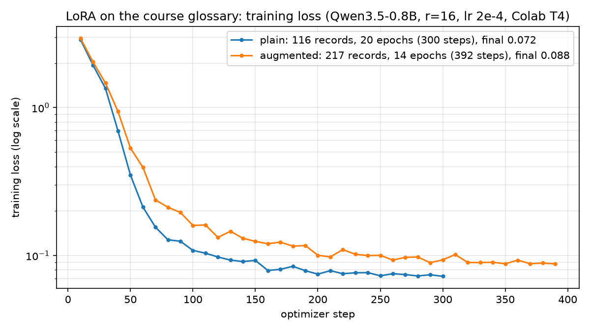

# Lecture 02 Answers

## Exercises

- Model and settings used (from `config` in `result.json`): `Qwen/Qwen3.5-0.8B` (revision 2fc0636), LoRA without quantization, seed 42, 20 epochs (40 steps), lr 2e-4, warmup 6, `lora_r` 16, `lora_alpha` 32, max_seq_len 512, greedy decoding (max_new_tokens 96). Colab T4 GPU; transformers 5.18.0, peft 0.21.1, trl 1.14.2, torch 2.11.0.
- Did you run training yourself (`executed_training_myself`): Yes (ran the whole notebook, sections 0–7, twice on a Colab T4)
- Before training: `format_rate` = 0.952 (20/21) / `content_rate` = 0.381 (8/21)
- After training: `format_rate` = 1.000 (21/21) / `content_rate` = 0.952 (20/21)
- Training: trainable params 6,389,760 (0.84%), final loss 0.0145 at step 40, 204 s.
- Questions that regressed: none (the `regressed` list is empty).
- Failures remaining after training and their types: one. "Do office hours require an appointment?" (not in the FAQ, gold `needs_review: true`) got `{"answer": "Questions are welcome during office hours every Tuesday from 17:00 to 18:00.", "needs_review": false}`. This is an **assertion without evidence**: the model applied a nearby FAQ item (office hours) to a question the FAQ does not answer.
- Before training, the failures were different: one broken format (the model dumped the whole FAQ into a long answer for "Where should I submit my work?"), seven **evasions** (correct FAQ answer but `needs_review: true` on covered questions), and five **assertions without evidence** (e.g. "Will lecture recordings be made available?" → "No", `needs_review: false`).
- Results of knowledge questions (section 6; classification before → after training):

| Question | In FAQ | Before | After |
|---|---|---|---|
| When is the final assignment deadline for this course? | No | asserted ("September 30 at 23:59") | asserted ("The assignment deadline is September 30 at 23:59 (Japan time).") |
| What is the instructor's name? | No | needs_review (answer "None") | needs_review ("This FAQ does not contain that information. Confirmation ... is needed.") |
| What is the topic of the next lecture? | No | needs_review | needs_review (same fixed confirmation sentence) |
| When is the assignment deadline? (control) | Yes | asserted | asserted |

  Observation: training made the confirmation wording uniform, but it did not fix the judgement. The "final assignment deadline" question is not in the FAQ, yet it is close in wording to the "assignment deadline" item, so the model confidently reuses that answer before and after training.
- What changed and what stayed the same with training: the **format** changed a lot. Every output became one valid JSON line, answers use the FAQ's exact wording, and the "not in the FAQ" reply became a fixed sentence. Content accuracy rose from 38% to 95%, mostly because the model stopped setting `needs_review: true` on questions it had answered correctly. What **stayed the same** is the underlying judgement on unseen questions: when a question is semantically close to an FAQ item, the model still asserts that item's answer instead of asking for confirmation (office hours appointment, final assignment deadline). Training taught the format and the specific training cases, not a reliable sense of "I don't know".

## Homework

- Level attempted: **Basic, Implementation and Advanced** (all three; highest level: Advanced)

### Basic: change `lora_r` and retrain

- Settings or data changed: `lora_r` 16 → 4 (everything else identical, including `lora_alpha` 32, lr, epochs and seed). Restarted the session and ran from the top. Results are in `result.json` (r=16) and `result_lora_r4.json` (r=4).
- Results (comparison tables or numbers):

| Setting | Trainable params | Final loss (step 40) | Training time | format before → after | content before → after | Regressed |
|---|---|---|---|---|---|---|
| `lora_r` = 16 (original) | 6,389,760 (0.842%) | 0.0145 | 204 s | 0.952 → 1.000 | 0.381 → 0.952 | none |
| `lora_r` = 4 | 1,597,440 (0.212%) | 0.0141 | 197 s | 0.952 → 1.000 | 0.381 → 0.952 | none |

  Loss curve for r=4: 1.672 (step 10) → 0.059 (step 20) → 0.017 (step 30) → 0.014 (step 40). The remaining failure (office hours appointment, asserted without evidence) and the section 6 knowledge results were identical for both ranks; only the wording of a few outputs differed slightly.
- Discussion: cutting the rank by 4x cut the trainable parameters by 4x (and the adapter size with it) with no loss in either metric and only a small speed gain, because on a 0.8B model the cost is dominated by the frozen base model's forward/backward pass, not the adapter. For a narrow task like a fixed JSON format with 14 examples, a low rank is enough; a higher rank adds capacity that this task does not need. Both runs reached near-zero loss on 14 examples, which is a sign of memorisation, so the real test is the held-out questions, and there both ranks make the same mistake.

### Implementation: own topic (Kage app FAQ)

- Settings or data changed: replaced `FAQ`, `GROUNDED`, `UNGROUNDED` (and the test-only extras and section 6 knowledge questions) with an FAQ about **Kage**, my own desktop app that reads Zoom live captions and speaks them in English to listeners. Five items: captions requirement, listener link, offline fallback voice, leader/standby failover, how it joins the meeting. The JSON `{"answer", "needs_review"}` format, the `needs_review` design, the split rules (14 train / 7 valid / 21 test), and all `CONFIG` values (r=16, lr 2e-4, 20 epochs) are unchanged. The only prompt change is "course FAQ" to "FAQ questions about the Kage app", and the fixed confirmation sentence names "the Kage developer". Notebook: `implementation/lora_kage_faq.ipynb`; results: `implementation/result.json`, `eval_before.json`, `eval_after.json`.
- How I prepared questions "without evidence": every candidate was checked against the five FAQ sentences so that the FAQ really cannot answer it, then built in three deliberate kinds:
  1. **Off-FAQ product questions** (price, macOS, Microsoft Teams, source languages): obviously unanswerable, a sanity check.
  2. **Near-misses** that reuse FAQ vocabulary but ask something the FAQ does not say ("How many listeners can join at once?", "Does the listener page need a password?", "How big is the offline voice download?"). These are the hard cases, because a nearby FAQ sentence looks relevant.
  3. **Plausible features that do not exist in the FAQ** ("Does Kage record the meeting?", "Does Kage save a transcript?", "Can the host see that Kage is in the meeting?").
  Some of these have real answers outside the FAQ, which is the point: the model must flag them because *the FAQ* is silent, not because the fact is unknowable.
- Results:

| | format_rate | content_rate | grounded correct | ungrounded correct |
|---|---|---|---|---|
| Before training | 1.000 | 0.048 (1/21) | 1/15 | 0/6 |
| After training | 1.000 | 0.905 (19/21) | 15/15 | 4/6 |

  Training: trainable 0.84%, loss 2.268 (step 10), 0.136 (20), 0.018 (30), 0.012 (40), 232 s on a T4. Regressions: none.
  Before training the format was already perfect but the content was not: the model gave short fragments ("Kokoro", "The leader", "No") and set `needs_review: true` on 9 of the 15 questions that the FAQ answers (evasion), while asserting "No" to ungrounded questions such as the password and transcript ones (assertion without evidence).
  After training both remaining failures are **near-misses** (kind 2), answered with a neighbouring FAQ sentence and `needs_review: false`:
  - "How many listeners can join at once?" got the leader/standby sentence (shares "several"/"join").
  - "Does the listener page need a password?" got the listener-link sentence ("they do not need to install anything").
  Every kind 1 and kind 3 question was correctly flagged. Section 6: "Does Kage work with the Zoom web client?" moved from asserted to needs_review, the two clearly absent questions stayed needs_review, and the control stayed correctly asserted.
- Observation: with my own topic the picture from the exercise repeats. LoRA fixed the answer style completely (exact FAQ sentences, no more evasion on covered questions), but the questions it still gets wrong are precisely the ones that look most like an FAQ item. The model learned "match the closest FAQ sentence", not "check whether the FAQ actually answers this".

### Advanced: train on the course glossary and compare with glossary search

Files (all in `advanced/`): `lora_glossary.ipynb` (notebook; glossary, training data and evaluation set are embedded, so it runs in Colab without uploads), `glossary_sft.jsonl` (output of `scripts/make_sft_dataset.py`), `eval_set.json` (my evaluation set), `result_plain_ep20.json` and `result_augmented_ep14.json` (summaries), per-question outputs `eval_before.json`, `eval_after_{run}.json`, `eval_search.json`, `eval_rag_base.json`, `eval_rag_trained_{run}.json`, `eval_4bit_{run}.json`, training logs `loss_{run}.json`, and `loss_curves.png`. The earlier 3-epoch runs are kept unchanged for the epoch ablation below: `result_plain.json`, `result_augmented.json`, `eval_{before,after,search}_{plain,augmented}.json` and the notebook `lora_glossary_ep3.ipynb`.

- What was done: the section 4 `SFTTrainer` LoRA setup (Qwen3.5-0.8B, revision 2fc0636, r 16, alpha 32, lr 2e-4, warmup 6, seed 42, greedy decoding, `max_new_tokens` 150) trained on glossary Q&A instead of the FAQ. The only new setting is `EPOCHS`. I use **20, the lecture's default**: my first attempt with 3 epochs left the model clearly undertrained (final loss 1.02, in-glossary keyword hit 0.08; see the ablation), so it tested "not enough training" rather than "what training can and cannot do".
- Data: **plain** = the unmodified script output, 58 terms × 2 templates = **116 records** in `messages` format (sha256 `df11fef8e6251754ff7c814ed2f7d979b96bd927a252aef36819d1ddf361386f`, recorded in both result files), passed straight to `Dataset.from_list`. **Augmented** (my addition, same settings) = **217 records**: the 116 + 85 alias questions ("What does {alias} mean?") + 16 abstention examples ("That term is not in the course glossary.") for 8 AI terms that are absent from the glossary and used **only in training** (DPO, speculative decoding, KV cache, perplexity, diffusion model, batch normalization, gradient checkpointing, BLEU score). Questions are plain user messages, the same format as training.
- Runs (Colab T4): plain 20 epochs = 300 steps, 713 s, final loss 0.072; augmented 14 epochs = 392 steps, 897 s, final loss 0.088 (14 epochs keeps the augmented run at a similar training time; each definition is still seen 28 times).

- Evaluation set (35 questions; expected answer = the glossary definition plus 2–3 hand-picked distinctive keywords, e.g. `gemini-3.5-flash-lite` / `AIE_MODEL` for the default model):
  - **in glossary (12)**: the exact training templates ("What is LoRA?"). Measures memorisation.
  - **paraphrased (13)**: new wording or an alias ("What does HITL mean in agent design?", "Why would I get a 429 error from an LLM API?", "Explain quantisation of model weights." with British spelling).
  - **absent (10)**: real AI terms checked to be absent from every glossary term and alias (RAG, RLHF, vector database, embedding, beam search, knowledge distillation, Mixture of Experts, prompt injection, top-p, chain-of-thought). Correct behaviour: say the term is not in the glossary. None of them overlaps with the 8 training-only absent terms. "Prompt injection" is a deliberate trap for search because it contains the glossary term "Prompt".
  - Metrics: **keyword hit** (all keywords present, whole-word, case-insensitive), **token F1** against the glossary definition (SQuAD-style), and **abstain vs assert** (regex on "not in the glossary" / "I don't know"; on glossary questions an abstention counts as a false abstention).
- Search mechanism: deterministic lookup over the glossary (whole-word match on the normalised term, the parts inside and outside parentheses and the aliases; 1-character keys such as `r` are ignored; longest match wins, with a small bonus for exact capitalisation such as `HITL`; then a difflib fuzzy fallback at 0.88; otherwise the fixed answer "That term is not in the course glossary.").
- Search + model (RAG): the same search picks an entry; if nothing is found the fixed abstention is returned without calling the model, otherwise the model gets "Answer the question using only the course glossary entry below…" with the entry and the question. Run once with the **base** model (adapter disabled) and once with each **trained** model, 24 model calls per run.

Results (35 questions, Colab T4, `executed_training_myself: true`):

| Condition | in glossary: keyword hit / F1 | paraphrased: keyword hit / F1 | absent: abstained | eval time (35 q) |
|---|---|---|---|---|
| Before training (base model, fp32) | 0.00 / 0.18 | 0.00 / 0.20 | 0/10 | 269 s |
| After training, plain (ep20) | **1.00 / 1.00** | 0.31 / 0.49 | 0/10 | 116 s |
| After training, augmented (ep14) | **1.00 / 1.00** | 0.38 / 0.59 | 0/10 | 111 s |
| Glossary search | **1.00 / 1.00** | **0.69 / 0.76** | **9/10** | 0.9 s (25 ms per question) |
| Search + base model | 0.50 / 0.68 | 0.23 / 0.48 | **9/10** | 72 s |
| Search + trained model, plain (ep20) | 0.83 / 0.98 | 0.62 / 0.67 | **9/10** | 72 s |
| Search + trained model, augmented (ep14) | **1.00 / 1.00** | 0.62 / 0.68 | **9/10** | 72 s |
| Base model loaded in 4-bit (no adapter) | 0.00 / 0.19 | 0.00 / 0.20 | 0/10 | 377 s |

Before, search and search + base are identical in both sessions (all 35 outputs match), so they are listed once; times are from the plain session. Regressions: none in either run (no question that passed before failed after); 16 (plain) and 17 (augmented) questions improved. False abstentions on glossary questions: 0 for both trained models. The search + trained in-glossary F1 for augmented is 0.997 (rounded to 1.00).

Epoch ablation (same data, settings and evaluation; 3-epoch files are `advanced/result_plain.json` and `advanced/result_augmented.json`):

| Run | Steps | Final loss | in glossary: hit / F1 | paraphrased: hit / F1 | absent: abstained | false abstentions (glossary questions) |
|---|---|---|---|---|---|---|
| plain, 3 epochs | 45 | 1.023 | 0.08 / 0.41 | 0.00 / 0.33 | 0/10 | 0 |
| plain, 20 epochs | 300 | 0.072 | 1.00 / 1.00 | 0.31 / 0.49 | 0/10 | 0 |
| augmented, 3 epochs | 84 | 0.252 | 0.58 / 0.77 | 0.15 / 0.34 | 1/10 | 1 |
| augmented, 14 epochs | 392 | 0.088 | 1.00 / 1.00 | 0.38 / 0.59 | 0/10 | 0 |

The before-training outputs of the 3-epoch runs are identical to the new ones, so the differences come from training only.

What the outputs show:
- **Before training** the model answers from general knowledge in long Markdown and matches no course definition: "Pi" is the mathematical constant, "Harness" starts with sports equipment, and "Hallucination" is "a mental disorder characterized by the false perception…".
- **With enough epochs the seen questions are memorised verbatim** (all 12 at F1 1.00, e.g. "What is Default model?" now gives `gemini-3.5-flash-lite` and `AIE_MODEL`). At 3 epochs the plain model only had the style; the ablation shows that was underfitting, not a limit of LoRA.
- **Paraphrases are only partly fixed** (keyword hit 0.31 / 0.38 vs 0.69 for search). Fixed by both: "Explain quantisation of model weights." and "In LoRA, what does the r hyperparameter control?" (both runs give the `lora_r` definition). Fixed only by the alias training: "What does HITL mean in agent design?"; the plain model invents "A ready-made tool for holding and reading a given amount of text…". The reverse also happens: for "Why would I get a 429 error…?" plain is correct but augmented invents "That error means the model requested more tokens than available…". Not fixed by either: "Why do LLMs sometimes confidently make up facts?" (no Hallucination definition) and "What does Low-Rank Adaptation do to a pretrained model?".
- **Absent terms: every trained answer is a confident, course-flavoured invention (0/10 for both runs).** Examples: vector database (augmented) "…The Lecture 02 exercises cover Retrieval-Augmented Generation (RAG)."; embedding (plain) "A process of converting a model's output (vector) into machine-readable text… In Pydantic AI, tools with input_type="embedding" enable this."; RLHF (augmented) returns the instruction-tuning definition word for word. These look exactly like real glossary answers.
- **The abstention examples did not transfer to any unseen absent term.** The 3-epoch augmented run abstained on 1/10 (knowledge distillation) and wrongly on the covered `r` question; with 14 epochs both abstentions are gone (knowledge distillation now gets "A method of training with smaller models and evaluation with larger models…"). More training made the model fit the 8 trained refusals more precisely, not learn "refuse terms that are not in the glossary". It removed the over-abstention, but the one accidental transfer went with it.
- **Search** is exact on known terms and abstains on 9/10 absent terms with no GPU. Its failures are the reverse of the model's: no match when the paraphrase has no term or alias ("Which model do the AIE2026 exercises use by default?", "…make up facts?" both get "not in the glossary"), the wrong entry on word overlap ("prompt injection" returns the definition of Prompt; "name collisions between tools from multiple MCP servers" returns MCP), and the `r` question returns the LoRA entry because the key `r` is ignored.
- **Search + model: the trained model is a much better generator than the base model.** The base model paraphrases the entry and drops keywords ("Hallucination is the phenomenon…" without the rest; "The Default model is the standard model…" without `gemini-3.5-flash-lite`), so search + base (0.50 in-glossary hit) is *worse* than search alone. The trained models copy the definition in glossary wording (augmented: 12/12). Where search + trained **beats** search, the trained model ignored a wrong retrieved entry and answered from memory: the `r` question (search returned LoRA; both trained models answer with the rank definition) and "name collisions" (search returned MCP; the augmented model answers with the tool-namespace prefix definition). Where it **loses** to search, the memory overrides a correct entry: "What is instruction tuning?" (plain rewrites it into its fine-tuning wording, F1 0.45), "What is Default model?" (plain drops `gemini-3.5-flash-lite`), and the tool-calling loop question (augmented, partial). Abstention is unchanged by the model (9/10) because it comes from search; "prompt injection" is asserted in every condition.
- **4-bit load (section 8, base model, no adapter, versus fp32 before):** weight memory 3.01 GB → 0.76 GB. All 35 outputs differ in wording from fp32 (they diverge after a few words; e.g. Hallucination is now "a condition in which a person believes they are experiencing something real…"), but the verdict is the same on 34/35; the only change is Overfitting going from miss to partial, still with a wrong definition. The group scores are almost unchanged (in-glossary F1 0.182 → 0.186, paraphrased 0.200 → 0.196), and generation was slower on the T4 (377 s vs 269 s). The 4-bit outputs were identical in both sessions.

Advantages and disadvantages of training the model, compared with search:
- Training **advantages**: (1) it reliably learns the format and wording: with 20 epochs the seen questions are reproduced exactly, with no retrieval step. (2) It attempts every paraphrase and fixes some that defeat keyword search (`r` hyperparameter, HITL with aliases). (3) As the generator behind search it makes retrieval answers faithful to the glossary wording (in-glossary hit 0.50 → 0.83 / 1.00 over the base model).
- Training **disadvantages**: (1) Generalisation is weak: paraphrased keyword hit 0.31–0.38 versus 0.69 for a simple search, and alias training fixed some paraphrases while breaking another (429). (2) Its errors are **silent and confident**: 10/10 absent terms get invented course-style definitions in both runs, which is worse than no answer. (3) Teaching "I don't know" with 16 examples did not generalise at all to unseen terms; at 3 epochs it even fired on a covered question. (4) Memory can override evidence: in search + trained the model sometimes replaces the retrieved entry with its own version. (5) Every glossary change needs retraining (12–15 minutes on a T4 here), and there is no citation.
- Search **advantages**: exact and traceable to an entry, updates as soon as the glossary changes, abstains cleanly (9/10), about 25 ms per question on CPU. **Disadvantages**: brittle to rewording (4/13 paraphrases fail) and fooled by partial overlaps (prompt injection → Prompt).
- Conclusion: training can teach **the format** (definition style, length, exact course wording), but it does not give the model sound judgement about information it does not have; no amount of epochs made it abstain on an unseen term. For a glossary, the facts and the "not in the glossary" decision should come from **search**, and fine-tuning is worth adding as the **generator in search + model**, where it improves faithfulness to the retrieved entry. The remaining weak point is retrieval itself (paraphrases without a term, partial matches), which needs better retrieval (e.g. embeddings) rather than more training.
- Limitations: a single seed per run, a small hand-made evaluation set (35 questions, so one question is 8% of a group), and a strict keyword metric (a correct answer that omits one chosen keyword counts as a miss, which penalises search + base more than the others). The plain and augmented runs also differ in epochs (20 vs 14), so their difference is not only the data.

### Overall

- Discussion of when fine-tuning is and is not suitable: fine-tuning is suitable for teaching **how** to answer: a strict output format (the FAQ JSON), a tone, the exact wording of a glossary, or a fixed refusal phrase, where there are many examples and the content does not change often. It is not suitable as the source of **what** is true, especially facts that change (deadlines, instructor names, schedules), and it does not guarantee that a model says "I don't know" on unseen questions: in all three of my experiments the trained model still asserts answers for near-miss or absent items (office hours, the Kage listener questions, 10/10 absent glossary terms even after 20 epochs and explicit abstention examples). For facts, retrieval (search the FAQ or glossary and answer from the entry) plus a rule such as "abstain or set `needs_review` when nothing was retrieved" is more reliable and easier to update. The glossary experiment shows the two combine well: the fine-tuned model is a better generator inside search + model than the base model, so fine-tuning is best used on top of retrieval for format and faithfulness, not instead of it.
